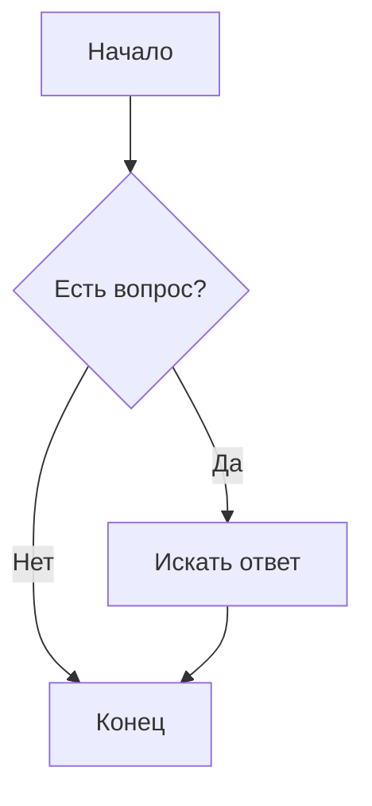

Блок кода с подсветкой синтаксиса (Python):
```python
def greet(name: str) -> str:
    """Функция приветствия."""
    return f"Привет, {name}!"

print(greet("Мир"))
```

Блок кода с подсветкой изменений (Diff):
```diff
- Удаленная строка кода
+ Добавленная строка кода
  Строка без изменений
```

---

## 6. Таблицы

Выравнивание задается двоеточиями в разделительной строке:
`:---` (по левому краю), `:---:` (по центру), `---:` (по правому краю).

| Левый край | По центру | Правый край | Код и стили |
| :--- | :---: | ---: | :--- |
| Ячейка 1 | Текст | 100 ₽ | `inline code` |
| Ячейка 2 | Длинный текст | 2 500 ₽ | **Жирный** |
| Ячейка 3 | Ссылка | 10 ₽ | [Ссылка](#) |

---

## 7. Сноски (Footnotes)

В тексте можно делать академические сноски[^1] или именованные сноски[^note].

[^1]: Текст первой сноски в самом низу документа.
[^note]: Текст именованной сноски. Может содержать несколько абзацев.

---

## 8. Математические формулы (LaTeX / KaTeX)

Встроенная формула в строке: $E = mc^2$.

Блочная формула по центру:
$$
\int_{a}^{b} x^2 \,dx = \frac{b^3 - a^3}{3}
$$

---

## 9. Диаграммы (Mermaid)

Многие платформы (GitHub, GitLab, Notion, Obsidian) рендерят код Mermaid в графики:



---

## 10. Разделители и экранирование

Три разных способа создать горизонтальную линию:

---
***
___

Экранирование спецсимволов с помощью обратного слеша `\`:
\*Это не курсив\*, а \# это не заголовок.

---

## 11. Встроенный HTML (Спойлеры и прочее)

Markdown поддерживает чистый HTML для нестандартных задач, например, для создания сворачиваемых блоков:

<details>
<summary>Нажмите, чтобы раскрыть спойлер</summary>

### Скрытый контент
Внутри спойлера можно использовать **обычный Markdown**, главное — оставить пустую строку после тега `<summary>`.

* Пункт А
* Пункт Б

</details>
